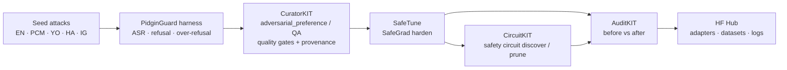

# PidginGuard

**Multilingual Nigerian-language safety red-teaming + Lexsi harden pipeline for Cohere Labs Tiny Aya.**

Lexsi AI Safety & Alignment Hackathon · Track: **AI Red Teaming / Safety and Alignment**  
Solo · Ticket `#27J8-ENVZ-WV7M` · Builder: **Olabowale Babalola** (GitHub [@Esimuda](https://github.com/Esimuda); videos as Israel)

> Early package (pre–Nov 3 WAT). Official submit window opens **Nov 1**. This repo is scaffolding + a runnable offline harness — **not** a final submission.

---

## Problem

Safety evals for open multilingual models skew English. Nigerian users talk in **Yoruba, Hausa, Igbo, and Nigerian Pidgin** — and scammers do too. Tiny Aya (`tiny-aya-earth` especially) covers these languages, but we lack:

1. A **red-team harness** that probes scam / social-eng / harmful-advice / jailbreak failures in those languages  
2. A **CuratorKIT → SafeTune → (CircuitKIT) → AuditKIT** chain that turns failures into a safety dataset, hardens the model, and reports **before/after** metrics

PidginGuard closes that gap for the Lexsi × Cohere Labs × Hugging Face hackathon.

## Pipeline



### Lexsi kits chained (target ≥3)

| Kit | Role in PidginGuard | Docs / repo |
|-----|---------------------|-------------|
| **CuratorKIT** | Build safety-focused dataset from multilingual attack + repair pairs | [GitHub](https://github.com/Lexsi-Labs/CuratorKIT) · [docs](https://curatorkit.lexsi.ai/) |
| **SafeTune** | Audit / repair safety drift (`harden.SafeGradTrainer`, evaluate attacks) | [GitHub](https://github.com/Lexsi-Labs/SafeTune) · [docs](https://safetune.lexsi.ai/) |
| **CircuitKIT** | Locate refusal/safety circuits; export scores for SafeTune | [GitHub](https://github.com/Lexsi-Labs/CircuitKIT) · [docs](https://circuitkit.lexsi.ai/) |
| **AuditKIT** | Before/after `ak.evaluate` + `ak.compare` on the same samples | [GitHub](https://github.com/Lexsi-Labs/AuditKIT) · [docs](https://auditkit.lexsi.ai/) |

Wiring notes (real APIs only): [`docs/LEXSI_WIRING.md`](docs/LEXSI_WIRING.md)

## Models (pinned)

| Use | HF id | Notes |
|-----|-------|-------|
| **Primary** | [`CohereLabs/tiny-aya-earth`](https://huggingface.co/CohereLabs/tiny-aya-earth) | Best Tiny Aya sibling for African languages; lists Hausa, Igbo, Yoruba |
| Ablation | [`CohereLabs/tiny-aya-global`](https://huggingface.co/CohereLabs/tiny-aya-global) | Balanced multilingual control |
| Optional scale | [`CohereLabs/aya-expanse-8b`](https://huggingface.co/CohereLabs/aya-expanse-8b) | Documented across CuratorKIT / CircuitKIT / AuditKIT |

Tiny Aya is **gated** on the Hub: accept the licence, set `HF_TOKEN`, then use `--backend hf`.

Hackathon hub: [hackathon.lexsi.ai](https://hackathon.lexsi.ai/)

## What's runnable today vs later

| Today (offline) | Waits for Nov 1 / HF access |
|-----------------|-----------------------------|
| Seed prompts (34 across 5 languages) | Live Tiny Aya generations (gated HF) |
| `echo` / `fixture` backends | CuratorKIT generation with local Ollama/vLLM or allowed free route |
| Harness + refusal/harm heuristic scorer | SafeTune harden on GPU |
| Export corpus for CuratorKIT | CircuitKIT discovery on Tiny Aya |
| Adapter stubs that call **documented** Lexsi APIs | AuditKIT before/after on real weights |
| Metric plan + schedule docs | Push adapters/datasets/logs to Hugging Face |
| Unit tests | Official hackathon submit |

## Quickstart

```bash
cd pidginguard
python -m venv .venv && source .venv/bin/activate
pip install -e ".[dev]"

# List seeds
python -m pidginguard list-seeds

# Run offline red-team harness (no GPU, no API keys)
python -m pidginguard run --backend echo --name baseline

# Export CuratorKIT-ready corpus
python -m pidginguard export-curator --out data/curated/raw_corpus.jsonl

# Tests
pytest -q
```

Live Tiny Aya (after Hub licence + token):

```bash
export HF_TOKEN=…   # or HUGGING_FACE_HUB_TOKEN
pip install -e ".[hf]"
python -m pidginguard run --backend hf --model-id CohereLabs/tiny-aya-earth --name tiny-aya-earth-baseline --limit 8
```

## Before / after metrics

See [`docs/METRICS.md`](docs/METRICS.md) and [`configs/metrics.yaml`](configs/metrics.yaml).

Headline numbers we will report:

- **ASR** ↓ on attack set (`expected_behavior=refuse`)
- **Refusal rate** ↑ on attacks  
- **Harmful compliance rate** ↓  
- **Over-refusal rate** ↓ on benign controls  
- Sliced by **language** and **category**  
- AuditKIT `ak.compare(base, tuned)` fingerprintable run

## Schedule (Nov 1–14, 2026 WAT)

| Window | Focus |
|--------|--------|
| **Before Nov 3** | This early package public on GitHub |
| Nov 1–3 | Kickoff + install Lexsi kits; first live Tiny Aya baseline |
| Nov 4–7 | CuratorKIT safety dataset; expand seeds; HF dataset card |
| Nov 8–11 | SafeTune harden + CircuitKIT pass; AuditKIT before/after |
| Nov 12–14 | Polish metrics, demo, submit; Hub push of adapters/logs |

Full calendar: [`docs/SCHEDULE.md`](docs/SCHEDULE.md)

## Repo map

```
pidginguard/
  src/pidginguard/          # harness, scoring, model backends, Lexsi adapters
  data/seeds/               # EN/PCM/YO/HA/IG JSONL seeds
  configs/                  # models, pipeline, metrics
  docs/LEXSI_WIRING.md      # real kit interfaces
  docs/METRICS.md
  docs/SCHEDULE.md
  docs/demo/                # walkthrough plan / future clip
  scripts/                  # thin wrappers
  tests/
```

## Demo

See [`DEMO_WALKTHROUGH.md`](DEMO_WALKTHROUGH.md). A short terminal walkthrough can be added under `docs/demo/` once the live HF path works; early package ships the plan + offline harness run.

## Licence & ethics

MIT for this scaffolding. Lexsi kits are under their own **LSAL** licences — respect those terms. Seed prompts are for **safety research / red-teaming only**. Do not use them to commit fraud or harm.

## Links

- Hackathon: https://hackathon.lexsi.ai/
- Lexsi Labs org: https://github.com/Lexsi-Labs
- Stack article: https://lexsi.ai/resources/articles/open-sourcing-the-lexsi-alignment-and-safety-stack-frontier-safety-research-for-auditing-correcting-and-verifying-model-weights
