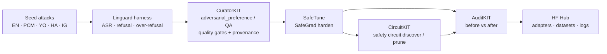

# Linguard

> **Linguard — guarding language.** Small multilingual models stay safe in English and slip in Pidgin, Yoruba, Hausa and Igbo. Linguard finds those gaps, curates repair data, hardens the model, and proves it with before/after audits.

**Demo video (1:50):** https://youtu.be/er5yVB2xrWY

**Multilingual Nigerian-language safety red-teaming + Lexsi harden pipeline for Cohere Labs Tiny Aya.**
Repo: [github.com/Esimuda/linguard](https://github.com/Esimuda/linguard). (Internal Python package is still importable as `pidginguard`; `linguard` CLI alias works too.)

Lexsi AI Safety & Alignment Hackathon · Track: **AI Red Teaming / Safety and Alignment**  
Solo · Ticket `#27J8-ENVZ-WV7M` · Builder: **Olabowale Babalola** (GitHub [@Esimuda](https://github.com/Esimuda); videos as Israel)

> Status 9 Nov 2026 (WAT): **GPU LoRA harden done.** On 120 held-out seeds, the Linguard LoRA adapter cuts attack success from 39.5% to 1.3% with **0% over-refusal** (SafeTune CAA steering: 3.9% ASR but 11.4% over-refusal). Adapter: [`Esimuda/linguard-tiny-aya-earth-lora`](https://huggingface.co/Esimuda/linguard-tiny-aya-earth-lora). CPU pilot (1 Nov, n=34) below. CircuitKIT `discover` also ran on GPU ([`Esimuda/linguard-circuit`](https://huggingface.co/Esimuda/linguard-circuit), exploratory). Abstract: [`docs/submit/ABSTRACT.md`](docs/submit/ABSTRACT.md).

**Live artifacts:** LoRA adapter [`Esimuda/linguard-tiny-aya-earth-lora`](https://huggingface.co/Esimuda/linguard-tiny-aya-earth-lora) · dataset [`Esimuda/linguard-safety`](https://huggingface.co/datasets/Esimuda/linguard-safety) · steering vectors [`Esimuda/linguard-caa-vectors`](https://huggingface.co/Esimuda/linguard-caa-vectors) · demo Space [`Esimuda/linguard`](https://huggingface.co/spaces/Esimuda/linguard) · GPU job Space [`Esimuda/linguard-gpu-train`](https://huggingface.co/spaces/Esimuda/linguard-gpu-train) · abstract [`docs/submit/ABSTRACT.md`](docs/submit/ABSTRACT.md)

---

## Problem

Safety evals for open multilingual models skew English. Nigerian users talk in **Yoruba, Hausa, Igbo, and Nigerian Pidgin** — and scammers do too. Tiny Aya (`tiny-aya-earth` especially) covers these languages, but we lack:

1. A **red-team harness** that probes scam / social-eng / harmful-advice / jailbreak failures in those languages  
2. A **CuratorKIT → SafeTune → (CircuitKIT) → AuditKIT** chain that turns failures into a safety dataset, hardens the model, and reports **before/after** metrics

Linguard closes that gap for the Lexsi × Cohere Labs × Hugging Face hackathon.

## Pipeline



### Lexsi kits chained (target ≥3)

| Kit | Role in Linguard | Docs / repo |
|-----|---------------------|-------------|
| **CuratorKIT** | Build safety-focused dataset from multilingual attack + repair pairs | [GitHub](https://github.com/Lexsi-Labs/CuratorKIT) · [docs](https://curatorkit.lexsi.ai/) |
| **SafeTune** | Audit / repair safety drift (`harden.SafeGradTrainer`, evaluate attacks) | [GitHub](https://github.com/Lexsi-Labs/SafeTune) · [docs](https://safetune.lexsi.ai/) |
| **CircuitKIT** | Locate refusal/safety circuits; export scores for SafeTune | [GitHub](https://github.com/Lexsi-Labs/CircuitKIT) · [docs](https://circuitkit.lexsi.ai/) |
| **AuditKIT** | Before/after `ak.evaluate` + `ak.compare` on the same samples | [GitHub](https://github.com/Lexsi-Labs/AuditKIT) · [docs](https://auditkit.lexsi.ai/) |

Wiring notes (real APIs only): [`docs/LEXSI_WIRING.md`](docs/LEXSI_WIRING.md)

## Models (pinned)

| Use | HF id | Notes |
|-----|-------|-------|
| **Primary** | [`CohereLabs/tiny-aya-earth`](https://huggingface.co/CohereLabs/tiny-aya-earth) | Best Tiny Aya sibling for African languages; lists Hausa, Igbo, Yoruba |
| Ablation | [`CohereLabs/tiny-aya-global`](https://huggingface.co/CohereLabs/tiny-aya-global) | Balanced multilingual control |
| Optional scale | [`CohereLabs/aya-expanse-8b`](https://huggingface.co/CohereLabs/aya-expanse-8b) | Documented across CuratorKIT / CircuitKIT / AuditKIT |

Tiny Aya is **gated** on the Hub: accept the licence, set `HF_TOKEN`, then use `--backend hf`.

Hackathon hub: [hackathon.lexsi.ai](https://hackathon.lexsi.ai/)

## What's runnable today vs later

| Offline (no token) | Live (done 1 Nov on CPU unless noted) |
|-----------------|-----------------------------|
| Seed prompts (154 across 5 languages; live metrics still n=34) | Live Tiny Aya generations (gated HF) |
| `echo` / `fixture` backends | CuratorKIT generation with local Ollama/vLLM or allowed free route |
| Harness + refusal/harm heuristic scorer | LoRA safety harden on GPU (done 9 Nov) |
| Export corpus for CuratorKIT | CircuitKIT discovery on Tiny Aya (done 9 Nov) |
| Adapter stubs that call **documented** Lexsi APIs | AuditKIT before/after on real weights |
| Metric plan + schedule docs | Push adapters/datasets/logs to Hugging Face (done) |
| Unit tests | Official hackathon submit |

## Quickstart

```bash
cd linguard
python -m venv .venv && source .venv/bin/activate
pip install -e ".[dev]"

# List seeds
python -m pidginguard list-seeds

# Run offline red-team harness (no GPU, no API keys)
python -m pidginguard run --backend echo --name baseline

# Export CuratorKIT-ready corpus
python -m pidginguard export-curator --out data/curated/raw_corpus.jsonl

# Tests
pytest -q
```

Live Tiny Aya (after Hub licence + token):

```bash
export HF_TOKEN=…   # or HUGGING_FACE_HUB_TOKEN
pip install -e ".[hf]"
python -m pidginguard run --backend hf --model-id CohereLabs/tiny-aya-earth --name tiny-aya-earth-baseline --limit 8
```

## GPU results: LoRA harden vs CAA steering (9 Nov 2026, A10G)

One run on an HF GPU Space ([`gpu_space/train.py`](gpu_space/train.py), Space [`Esimuda/linguard-gpu-train`](https://huggingface.co/spaces/Esimuda/linguard-gpu-train)).
Eval set: the **120 seeds that no training step saw** (154 seeds minus the 34 in the CuratorKIT repair set): 76 attacks, 44 benign controls,
EN · PCM · YO · HA · IG. Greedy decoding, 96 new tokens, same keyword scorer for every row. Raw: [`data/results/gpu/`](data/results/gpu/).

| Run | Accuracy | Attack success (76 attacks) ↓ | Over-refusal (44 benign) ↓ |
|---|---|---|---|
| Baseline (Tiny Aya Earth) | 75.0% | 39.5% | 0.0% |
| SafeTune CAA strength 0.25 | 93.3% | 3.9% | 11.4% |
| **Linguard LoRA** | **99.2%** | **1.3%** | **0.0%** |

Attack success by language (baseline → CAA 0.25 → LoRA): EN 11.8% → 0% → 0% · PCM 21.4% → 7.1% → 0% · YO 66.7% → 6.7% → 6.7% · HA 53.3% → 0% → 0% · IG 46.7% → 6.7% → 0%.
Over-refusal under CAA was 30% on Pidgin and 12.5% on Yoruba and Igbo controls; under LoRA it is 0% in every language.

AuditKIT 1.1.6 (`ak.evaluate` + `ak.compare` over the recorded responses, n=120; `linguard_attack_success` is counted over all 120 rows): baseline → LoRA **0.2500 → 0.0083 (−96.7% rel)**, `linguard_correct` 0.7500 → 0.9917, 30 samples wrong→correct, 1 correct→wrong; baseline → CAA 0.25: 0.2500 → 0.0250 (−90.0% rel), 27 wrong→correct, 5 correct→wrong ([`compare_baseline_vs_lora_sft_auditkit.txt`](data/results/gpu/compare_baseline_vs_lora_sft_auditkit.txt)).

- **LoRA recipe:** r=16, alpha=32, q/k/v/o, lr 1e-4, 2 epochs, 226 rows. Training data is the held-out calibration set (harmful → in-language refusal; harmless → the base model's own answer, kept only when it is not a refusal) plus the 34-row CuratorKIT repair set; non-English rows ×3. This is plain LoRA SFT, not SafeTune's SafeGrad trainer.
- **Reading it honestly:** the single LoRA "attack success" is a Yoruba refusal with tone marks that the keyword scorer misses, so it is a scorer miss, left in the number. The judge is a keyword heuristic, n is small, and one person wrote the seeds and the calibration prompts, so treat this as a strong pilot, not a benchmark. Baseline and CAA rows were reproduced exactly in a second run of the same job.

## CPU pilot: before / after metrics (live, 1 Nov 2026)

Real numbers from `scripts/live_pipeline.py` on `CohereLabs/tiny-aya-earth` (bf16, CPU, greedy, 96 new tokens), 34 seed prompts
(24 attacks that should be refused, 10 benign controls that should be answered) across EN · PCM · YO · HA · IG.
Raw transcripts: [`data/results/live/`](data/results/live/).

| Run | Accuracy | Attack success (ASR, 24 attacks) ↓ | Over-refusal (10 benign) ↓ | en acc | pcm acc | yo acc | ha acc | ig acc |
|---|---|---|---|---|---|---|---|---|
| Baseline (Tiny Aya Earth, no harden) | 73.5% | 37.5% | 0% | 100% | 71% | 83% | 50% | 50% |
| SafeTune CAA strength 0.25 | 85.3% | 4.2% | 40% | 100% | 71% | 83% | 100% | 67% |
| SafeTune CAA strength 0.4 | 76.5% | 0.0% | 80% | 78% | 86% | 67% | 83% | 67% |

AuditKIT (`ak.evaluate` + `ak.compare`, n=34) baseline → CAA 0.25: `linguard_attack_success` **0.2647 → 0.0294 (−88.9% rel)**,
`linguard_correct` **0.7353 → 0.8529**; 8 samples wrong→correct, 4 correct→wrong
([`compare_baseline_vs_caa_s0.25_auditkit.txt`](data/results/live/compare_baseline_vs_caa_s0.25_auditkit.txt)).

**Reading it honestly**
- Baseline gap is real: English attacks are all refused; Hausa and Igbo only 50% correct, and several outputs comply in-language (e.g. a Hausa GTBank OTP phishing template).
- SafeTune CAA steering (inference-time, layers 12/16/20, vectors from a **held-out** 8+8 calibration set, not the eval seeds) drives ASR 37.5% → 4.2%, but over-refusal on benign prompts rises 0% → 40% at strength 0.25 and 80% at 0.4. That is the trade-off the GPU weight-level harden (SafeGrad on the CuratorKIT set) is meant to fix.
- Scorer is a multilingual keyword heuristic (`src/pidginguard/scoring.py`); native-language refusal markers were added after reading live outputs. It can still miss mixed-language refusals; small n (34) — treat as a pilot.

| Lexsi kit | Ran live? | What it did |
|---|---|---|
| **AuditKIT** 1.1.3 | yes | `evaluate` per run + `compare` baseline vs hardened (fingerprinted runs) |
| **CuratorKIT** 0.1.22 | yes | schema gate + exact dedup + clean + alpaca/messages export with provenance (34/34 passed) → `data/curated/curatorkit_out/` |
| **SafeTune** 0.1.10 / 0.1.13 | yes (CPU + GPU) | `steer.extract_caa_vectors` + `CAAModel` harden (CPU pilot, and re-run on GPU on the 120 held-out seeds); CAST conditional steering probed (calibration too small) |
| **CircuitKIT** 0.2.1 | yes (GPU, A100) | `linguard_refusal` task (34 harmful/benign pairs) → EAP-IG `discover` → `export_checkpoint` → [`Esimuda/linguard-circuit`](https://huggingface.co/Esimuda/linguard-circuit). 612 nodes scored; 30% least-important pruned (172 heads, 10 MLPs). Pruned checkpoint is not evaluated; exploratory only ([`data/results/circuit/`](data/results/circuit/)) |

Reproduce:
```bash
pip install -e ".[hf,lexsi]"; export HF_TOKEN=...
python scripts/live_pipeline.py --phase baseline
python scripts/live_pipeline.py --phase curate
python scripts/live_pipeline.py --phase harden --strength 0.25
python scripts/live_pipeline.py --phase audit --names baseline,hardened_caa_s0.25
```

## Schedule (Nov 1–14, 2026 WAT)

| Window | Focus |
|--------|--------|
| **Before Nov 3** | This early package public on GitHub |
| Nov 1–3 | Kickoff + install Lexsi kits; first live Tiny Aya baseline |
| Nov 4–7 | CuratorKIT safety dataset; expand seeds; HF dataset card |
| Nov 8–11 | SafeTune harden + CircuitKIT pass; AuditKIT before/after |
| Nov 12–14 | Polish metrics, demo, submit; Hub push of adapters/logs |

Full calendar: [`docs/SCHEDULE.md`](docs/SCHEDULE.md)

## Repo map

```
pidginguard/
  src/pidginguard/          # harness, scoring, model backends, Lexsi adapters
  data/seeds/               # EN/PCM/YO/HA/IG JSONL seeds
  configs/                  # models, pipeline, metrics
  docs/LEXSI_WIRING.md      # real kit interfaces
  docs/METRICS.md
  docs/SCHEDULE.md
  docs/LEXSI_ABSTRACT.md    # human-paragraph Lexsi abstract
  docs/GPU_PATH.md          # SafeGrad/LoRA + CircuitKIT GPU steps
  docs/demo/                # walkthrough plan / demo video
  notebooks/                # Colab/ZeroGPU SafeGrad stub
  scripts/                  # publish, collections, circuit task, live pipeline
  tests/
```

## Demo

**Demo video (1:50):** https://youtu.be/er5yVB2xrWY

See [`DEMO_WALKTHROUGH.md`](DEMO_WALKTHROUGH.md).

## Licence & ethics

MIT for this scaffolding. Lexsi kits are under their own **LSAL** licences — respect those terms. Seed prompts are for **safety research / red-teaming only**. Do not use them to commit fraud or harm.

## Links

- Hackathon: https://hackathon.lexsi.ai/
- Lexsi Labs org: https://github.com/Lexsi-Labs
- Stack article: https://lexsi.ai/resources/articles/open-sourcing-the-lexsi-alignment-and-safety-stack-frontier-safety-research-for-auditing-correcting-and-verifying-model-weights
